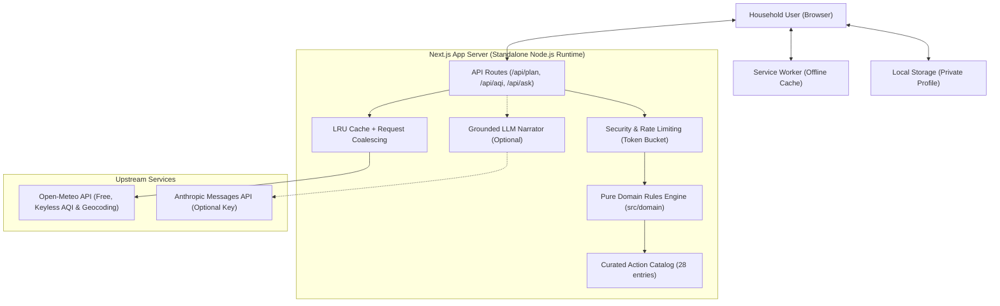

# Clear Air Companion 🌬️

> GenAI assistant for families and communities navigating severe winter smog.

[](https://github.com/your-org/clear-air-companion/actions/workflows/ci.yml)
[](LICENSE)

During severe winter smog (PM2.5 > 300 µg/m³), households in affected regions (such as the Indo-Gangetic Plain) face generic, unhelpful advice. Clear Air Companion solves this with three core actions:

1. **Suggest**: Low-emission daily routines, indoor air quality hacks, and sustainable alternatives.
2. **Tailor**: Customized to your live air quality, household members, housing type, and budget.
3. **Explain**: Direct personal and community impact with honest uncertainty ranges, confidence levels, and citations.

---

## Architecture Diagram



---

## Quickstart

### Prerequisites
- Node.js 20+
- npm 10+

### Local Setup
```bash
# 1. Clone repository
git clone <repo-url>
cd clear-air-companion

# 2. Install pinned dependencies
npm ci

# 3. Setup environment configuration
cp .env.example .env.local

# 4. Start development server
npm run dev
```

Open [http://localhost:3000](http://localhost:3000).

---

## Zero-Key / No-Key Mode

Clear Air Companion is **100% functional without an AI API key**.

- If `ANTHROPIC_API_KEY` is omitted, the application uses its deterministic rules engine (`src/domain/plan.ts`).
- Upstream air quality and geocoding rely on Open-Meteo's public API, which requires no API key.
- If Open-Meteo is unreachable, users can enter a manual AQI value or city search.
- Household profiles are saved in your browser's `localStorage` — **zero user data is persisted on the server**.

---

## How Impact Numbers Are Sourced

Every action in Clear Air Companion's curated catalog (`src/catalog/catalog.json`) cites scientific evidence:

- **Personal Exposure Reduction**: Sourced from peer-reviewed literature (WHO 2021 Global Air Quality Guidelines, EPA 2023 PM2.5 reviews, and Indian CPCB studies).
- **Honest Uncertainty**: Impact is presented as ranges with stated confidence levels (e.g., *"30% to 50% indoor PM2.5 reduction; Moderate confidence"*).
- **Community Scaling**: Community calculators project total emissions averted when 10, 50, or 500 households adopt an action, based on standard emission factors.

---

## Quality, Testing & Verification Commands

```bash
# Complete quality gate (Format, Lint, Types, Dead code, Circular deps, Tests)
npm run check

# Unit & integration tests with domain coverage report (threshold ≥ 90%)
npm run test:coverage

# Playwright E2E & automated WCAG 2.1 AA accessibility checks
npm run test:e2e

# Production build (standalone output, bundle check)
npm run build

# Automated production smoke test
bash scripts/smoke.sh http://localhost:3000
# On Windows:
pwsh scripts/smoke.ps1 -BaseUrl http://localhost:3000
```

---

## Docker & Production Deployment

```bash
# Build multi-stage standalone container
docker build -t clear-air-companion:v1.0.0 .

# Run container (unprivileged nextjs user, port 3000)
docker run -d -p 3000:3000 clear-air-companion:v1.0.0
```

See [docs/DEPLOYMENT.md](docs/DEPLOYMENT.md) and [docs/RUNBOOK.md](docs/RUNBOOK.md) for full operational guides.

---

## Disclaimer

Clear Air Companion provides actionable environmental and lifestyle guidance, **not medical diagnosis or treatment**. Anyone experiencing acute breathing distress, chest pain, or severe symptoms should seek immediate medical attention.

---

## License

MIT © 2026 Clear Air Companion Contributors
