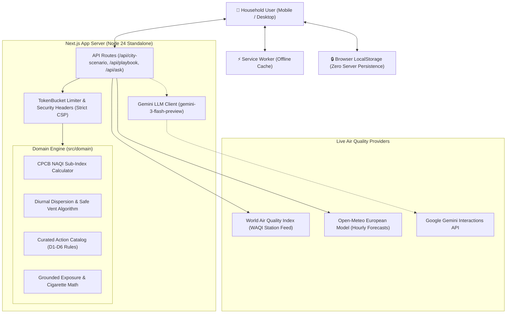

# VayuSaathi (वायु साथी) — Clear Air Companion 🌬️

> **Actionable, privacy-first winter smog resilience companion for Indian households and communities.**  
> Moving families from passive AQI panic to practical physical engineering, safe ventilation windows, and collective clean air action.

[](https://github.com/Aryan24a-git/Vayu-Saathi)
[](https://nextjs.org/)
[](https://nodejs.org/)
[](https://www.typescriptlang.org/)
[](https://ai.google.dev/)
[](https://tailwindcss.com/)
[](LICENSE)

---

## 🎯 The Problem

During winter smog across North and Eastern India (Delhi, Lucknow, Patna, Kolkata), particulate pollution regularly exceeds **300–500+ µg/m³ PM2.5**—the physiological equivalent of smoking 15–25 cigarettes a day.

Most air quality apps are **digital panic buttons**: they display a terrifying red number and tell users to "stay indoors". But ordinary families still commute, cook in unsealed homes, and cannot afford ₹15,000–₹35,000 commercial air purifiers for every room. Furthermore, well-intentioned common habits—such as dry broom sweeping (*jhadu*) or opening windows during morning thermal inversions—actually pull toxic particles directly into children's breathing zones.

---

## 💡 The Solution: VayuSaathi

**VayuSaathi** bridges atmospheric science and everyday household reality through a **Dual-Engine Architecture**:

1. **Physical Dispersion & Meteorology Engine**: Analyzes 24-hour diurnal wind speed and PM dispersion curves to calculate the exact **Safe Cross-Ventilation Window** (when midday solar convection dilutes surface smoke) and warns users before the **Evening Thermal Inversion** traps toxic exhaust at ground level.
2. **Grounded Gemini 3.0 Flash AI**: Translates CPCB National AQI sub-indices into hyper-local, empathetic guidance tailored to household vulnerabilities (infants, asthmatics, seniors) and budget tiers (from ₹0 habit swaps to ₹2,000 DIY MERV-13 box-fan purifiers).
3. **Live Impact Meter**: Replaces vague suggestions with transparent cause-and-effect math showing exact indoor exposure reduction (e.g. *-45% PM2.5*), cigarette-equivalents avoided, and community emissions averted.
4. **1-Click WhatsApp Community Broadcasts**: Generates ready-to-send bilingual (**English & हिन्दी**) morning bulletins for apartment societies, Resident Welfare Associations (RWAs), and school carpools.
5. **Zero-Tracking Privacy**: 100% on-device `localStorage`, zero telemetry or user tracking, and geographic coordinates truncated to 2 decimal places.

---

## 🏛️ System Architecture



---

## ✨ Key Features

| Feature | Description | Impact |
|---|---|---|
| **Safe Cross-Ventilation Window** | Diurnal curve algorithm identifying lowest-PM2.5 midday hours | Prevents carbon dioxide / VOC buildup while keeping peak smog out |
| **Evening Inversion Countdown** | Real-time warning before atmospheric boundary layer collapses | Tells families the exact hour to seal doors and balcony sliders |
| **Budget-Tiered Playbook** | Actionable engineering from ₹0 (wet mopping, damp towel draft stopping) to ₹2,000 DIY box-fan filters | Accessible protection for low- and middle-income families |
| **Live Impact Meter** | Transparent math displaying % exposure cut, cigarettes avoided, and CO₂ saved | Proven behavioral feedback driving daily completion |
| **Grounded AI Copilot** | Gemini 3.0 Flash assistant operating with strict guardrails (zero medical claims, grounded numbers) | Plain English/Hinglish answers to household air quality questions |
| **Bilingual WhatsApp Generator** | Instant morning alert generator formatted for society and RWA groups (English + Hindi) | Spreads clean air practices across entire neighborhoods |
| **Zero-Persistence Privacy** | No logins, no server-side databases, private profile in browser storage | Complete data sovereign privacy by default |

---

## 🚀 Quickstart

### Prerequisites
- **Node.js**: `20.19.0` or `24.x LTS` (Node 24 recommended)
- **npm**: `10+`

### Installation & Run

```bash
# 1. Clone the repository
git clone https://github.com/Aryan24a-git/Vayu-Saathi.git
cd Vayu-Saathi

# 2. Install dependencies
npm ci

# 3. Configure environment variables
cp .env.example .env.local

# 4. (Optional) Add your Google Gemini API Key in .env.local:
# GEMINI_API_KEY=your_gemini_api_key_here
# GEMINI_MODEL=gemini-3-flash-preview

# 5. Start the development server
npm run dev
```

Open [http://localhost:3000](http://localhost:3000) in your browser.

---

## 🔑 Zero-Key / Offline Fallback Mode

VayuSaathi is designed for resilience and **functions 100% reliably even without an AI API key**:
- If `GEMINI_API_KEY` is not provided or rate-limited, the application seamlessly runs on its **deterministic rules engine** (`src/domain/playbookEngine.ts`).
- Upstream air quality automatically queries WAQI or Open-Meteo's open endpoints.
- If upstream networks fail, users can instantly enter manual AQI readings or use cached offline data.

---

## 🧪 Verification & Quality Suite

Every commit adheres to strict automated quality gates:

```bash
# Run full verification suite (Format, Lint, TypeScript, Knip, Madge, Vitest)
npm run check

# Run unit and integration tests (31 test files, 137 tests passing)
npm run test

# Run Playwright E2E integration test
npm run test:e2e

# Production build test (Next.js Standalone with Turbopack)
npm run build
```

---

## 📖 Project Structure

```
├── src/
│   ├── app/                 # Next.js App Router (layout, page, API routes)
│   ├── catalog/             # Curated, scientific clean-air action catalog
│   ├── domain/              # Pure TypeScript business & atmospheric logic
│   │   ├── naqi.ts          # Official CPCB NAQI calculation & breakpoints
│   │   ├── ventilation.ts   # Diurnal boundary-layer ventilation algorithm
│   │   ├── playbookEngine.ts# Deterministic & AI playbook synthesizers
│   │   └── scenarios.ts     # Household profile definitions & impact models
│   ├── features/            # Modular React client UI components
│   │   ├── hero/            # Hero section, AQI badge, 24h dispersion chart
│   │   ├── playbook/        # Impact meter, checklist cards, AI explainer
│   │   ├── copilot/         # Grounded conversational assistant
│   │   ├── community/       # RWA WhatsApp generator, local action pinboard
│   │   └── profile/         # Drawer for vulnerability & housing settings
│   └── server/              # Server-only providers, LLM client, rate limiters
├── tests/
│   ├── unit/                # Unit tests for domain, math, and API routes
│   ├── integration/         # Security boundary & error handling tests
│   └── e2e/                 # End-to-end browser click-through specs
└── docs/                    # Architectural, security, and accessibility documentation
```

---

## ⚠️ Medical Disclaimer

VayuSaathi provides actionable physical engineering and environmental lifestyle recommendations. It does **not** provide medical diagnosis, clinical advice, or drug prescriptions. Individuals with severe chronic pulmonary conditions, acute asthma attacks, or chest pain should seek immediate professional medical assistance.

---

## 📄 License

Licensed under the [MIT License](LICENSE). © 2026 VayuSaathi Contributors.
