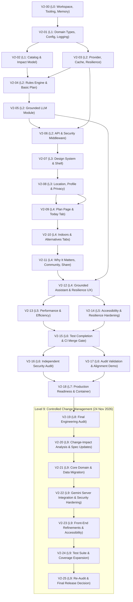

# docs/EXECUTION_MAP.md — Phase 4 & Phase 5 Project Execution Map
> Version: 2.0.0 | Stage: Phase 5 / Change Request V2-20..V2-25 | Authority: P1–P14 Shared V2 Protocol / Rule 7

This document defines the complete Project Execution Map for Clear Air Companion and VayuSaathi, recording stages V2-00 through V2-19 (Initial Build) and V2-20 through V2-25 (Controlled Change Management).

---

## 1. Execution Dependency Graph

---

## 2. Complete Stage-by-Stage Execution Map

| V2 | Level | Objective | Depends on | Primary Outputs | Key Requirements | Validation Method | Completion Gate | Verified Status |
|---|---|---|---|---|---|---|---|---|
| **00** | 0 | Workspace, tooling, memory, rules | none | Tooling config, `docs/`, `memory.md`, `AGENTS.md` | NFR-001/003/004, DEP-003 | `npm ci`, `check`, `build` | Toolchain green, memory exists | **COMPLETE (VERIFIED)** |
| **01** | 1 | Types, config, errors, logging | 00 | Domain types, `env.ts`, `logger.ts` | REQ-002, SEC-001/009 | `npm run check`, coverage | Redaction & env tests pass | **COMPLETE (VERIFIED)** |
| **02** | 1 | Catalog and impact model | 01 | `catalog.json`, calculator, `EVIDENCE.md` | REQ-004 to 008, DATA-004 | Catalog schema test | Every action sourced | **COMPLETE (VERIFIED)** |
| **03** | 2 | Provider, cache, resilience | 01 | Providers, LRU cache, circuit breaker | REQ-003, PERF-002, REL-001 | Failure-injection tests | All failure modes typed | **COMPLETE (VERIFIED)** |
| **04** | 2 | Rules engine, basic plan | 01–03 | Plan builder, golden fixtures | REQ-004 to 008/010 | Golden fixtures, benchmark | Offline plan works | **COMPLETE (VERIFIED)** |
| **05** | 2 | Grounded LLM module | 04 | LLM client, guardrails, corpus | REQ-009/011, SEC-004 | Guardrail suite | Invalid output falls back | **COMPLETE (VERIFIED)** |
| **06** | 2 | API and security middleware | 03–05 | API routes, limiter, headers, `API.md` | SEC-001/003/005/010, REL-002 | Integration tests | Matrix rows covered | **COMPLETE (VERIFIED)** |
| **07** | 3 | Design system and shell | 06 | Tokens, base UI shell, `i18n/en.json` | A11Y-001/002, PERF baseline | Axe, contrast, bundle check | No serious axe issues | **COMPLETE (VERIFIED)** |
| **08** | 3 | Location, profile, privacy | 07 | Profile wizard, storage, privacy UI | REQ-001/002/015, DATA-002/003 | Component, E2E | Keyboard setup works | **COMPLETE (VERIFIED)** |
| **09** | 4 | Plan page and Today tab | 06, 08 | Plan UI, Today tab, degraded states | REQ-003/004/007/010/014 | E2E journey, failure tests | Degraded modes visible | **COMPLETE (VERIFIED)** |
| **10** | 4 | Indoors and alternatives | 09 | Indoors tab, Alternatives tab, ImpactMeter | REQ-005/006/007 | Component, E2E | Budget filter correct | **COMPLETE (VERIFIED)** |
| **11** | 4 | Why it matters, community, share | 10 | Impact summary, community calculator, share | REQ-007/012/016 | Unit, E2E | No figure without basis | **COMPLETE (VERIFIED)** |
| **12** | 4 | Assistant and resilience UX | 05, 11 | Grounded assistant UI, error views | REQ-011, SEC-004 | Adversarial UI tests | Works with LLM off | **COMPLETE (VERIFIED)** |
| **13** | 5 | Performance and efficiency | 12 | `docs/PERFORMANCE.md`, optimizations | PERF-001 to 005 | Measurements, benchmarks | Budgets met or logged | **COMPLETE (VERIFIED)** |
| **14** | 5 | Accessibility and resilience | 12 | `docs/ACCESSIBILITY.md`, fixes | A11Y-001 to 006 | Axe audit, 320px reflow | Checklist recorded honestly | **COMPLETE (VERIFIED)** |
| **15** | 6 | Test completion and CI gate | 13, 14 | `.github/workflows/ci.yml`, `TEST_MATRIX.md` | TEST-001 to 006, SEC-008 | Full local run, flake check | All gates green | **COMPLETE (VERIFIED)** |
| **16** | 6 | Independent security audit | 15 | `docs/SECURITY_AUDIT.md` | SEC-001 to 010 | Scans, adversarial corpus | Zero unmitigated Critical/High | **COMPLETE (VERIFIED)** |
| **17** | 6 | Audit validation & alignment demo| 15, 16 | `docs/AUDIT_VALIDATION.md`, alignment demo | A11Y, PERF, REL, EC-002 | Prod build, alignment demo | No release blockers | **COMPLETE (VERIFIED)** |
| **18** | 7 | Production readiness | 16, 17 | `Dockerfile`, `.dockerignore`, `cd.yml`, `RUNBOOK.md` | DEP-001 to 004, REL-003 | Standalone boot, smoke test | Container verified | **COMPLETE (VERIFIED)** |
| **19** | 8 | Final audit & release gate | 18 | `docs/FINAL_AUDIT.md`, updated `memory.md` | ALL (REQ, SEC, A11Y, PERF, REL, DATA, TEST, EC) | Full re-run (all suites) | Release decision issued | **STALE (SUPERSEDED BY CR)** |
| **20** | 9 | Change-Impact Analysis & Spec Updates | 19 | `docs/REQUIREMENTS.md`, `TRACEABILITY.md`, `EXECUTION_MAP.md` | ALL modified IDs | Impact review, matrix reset | Requirements & traceability updated | **IN_PROGRESS** |
| **21** | 9 | Core Domain & Data Migration | 20 | Schema v2, CPCB NAQI engine, honest labels | REQ-002, REQ-022, REQ-023, REQ-025, DATA-004 | Unit tests, schema tests | Schema migration & pure math green | **PENDING** |
| **22** | 9 | Gemini Server Integration & Security | 21 | Gemini client, magic byte check, env config | REQ-009, REQ-011, REQ-024, SEC-011/012, DATA-005, DEP-003 | Unit tests, guardrail suite | Gemini server-only & image check pass | **PENDING** |
| **23** | 9 | Front-End Refinements & Accessibility | 22 | Focus trap, keyboard dropzone, heuristic window | REQ-017 to 021, A11Y-007, PERF-006 | Axe audit, E2E viewports | WCAG 2.1 AA green across all tabs | **PENDING** |
| **24** | 9 | Test Suite & Coverage Expansion | 23 | New test files, expanded journeys | TEST-001 to TEST-006 | `npm run check`, Playwright | All 104+ unit & E2E tests pass | **PENDING** |
| **25** | 9 | Re-Audit & Final Release Decision | 24 | `docs/FINAL_AUDIT.md`, `memory.md` | ALL (REQ-001 to 025, SEC, A11Y, PERF, REL, DATA, EC) | Full check, production smoke | Re-earned release verdict | **PENDING** |
